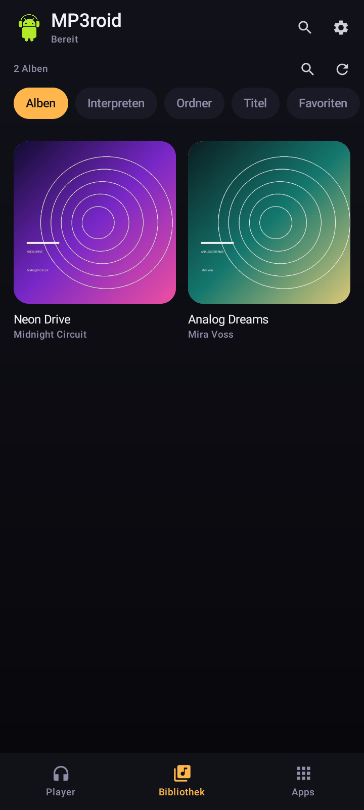
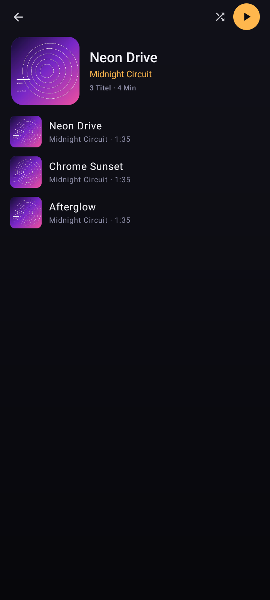
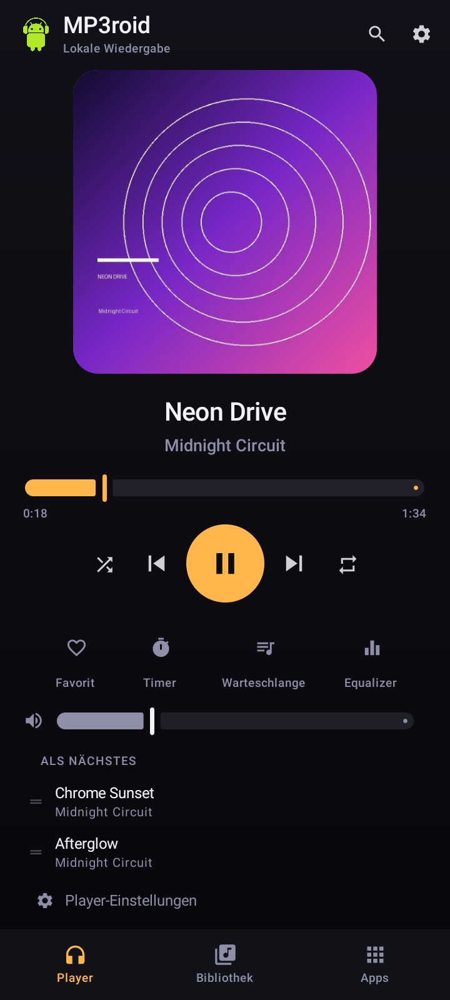
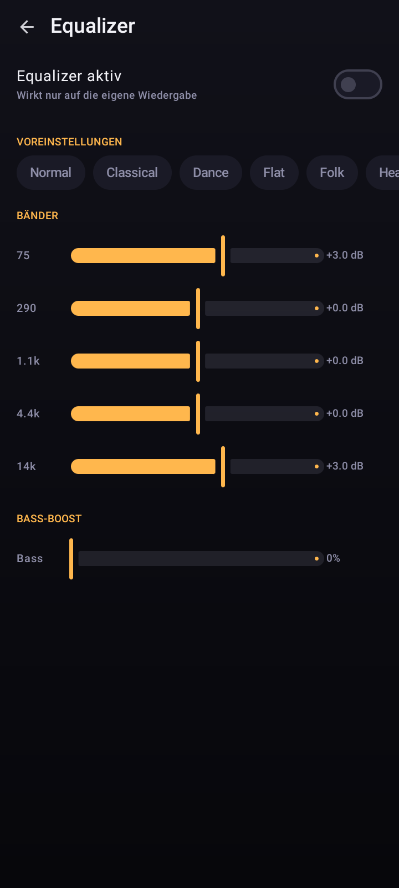
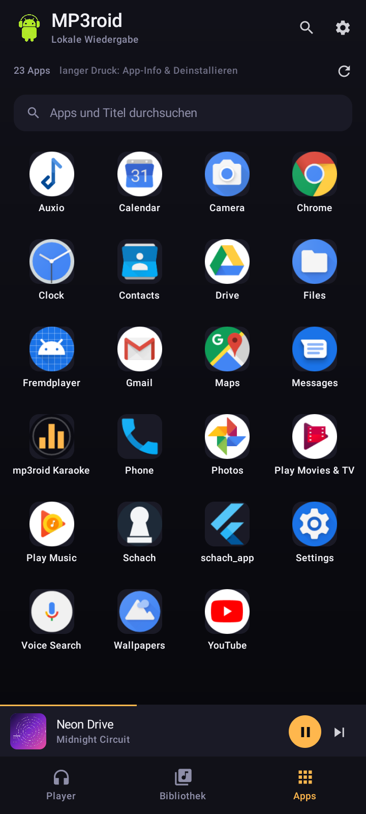
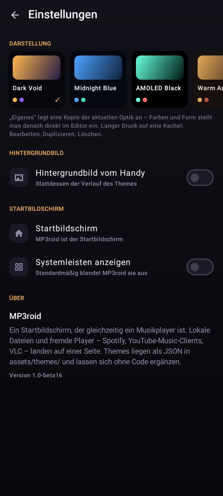
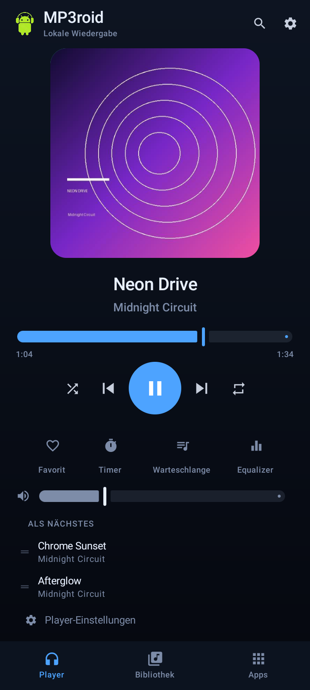

# MP3roid

**A home screen that is also a music player.**

MP3roid replaces the Android home screen and plays local music. Whatever other
players are currently playing – Spotify, YouTube Music clients, VLC – shows up in
the same place, with title, artwork and controls. Everything runs in a single UI:
no ads, no account, no network access.

## What it is for

MP3roid is mainly meant for two things: giving an old Android phone a second life
as a dedicated MP3 player, and letting children listen to music on a phone that
does not need to be a full smartphone. The launcher keeps music front and centre,
works entirely offline and has no ads.

> Status: beta (`1.0-beta16`). Requires Android 10 (API 29) or newer. The
> ready-to-install APK is on the
> [Releases](https://github.com/Natrium11-sudo/MP3roid/releases) page.

## Screenshots

<table>
  <tr>
    <td></td>
    <td></td>
    <td></td>
  </tr>
  <tr>
    <td align="center">Library</td>
    <td align="center">Album</td>
    <td align="center">Player</td>
  </tr>
  <tr>
    <td></td>
    <td></td>
    <td></td>
  </tr>
  <tr>
    <td align="center">Equalizer</td>
    <td align="center">Apps</td>
    <td align="center">Settings with themes</td>
  </tr>
</table>

<p align="center">
  
  <br>
  <sub>The “Midnight Blue” theme – colors and shapes are swappable via JSON.</sub>
</p>

## Features

- **Home screen:** replaces the launcher; the home button always leads back to
  the player.
- **Local playback:** MP3, M4A and OGG via Media3/ExoPlayer, with notification,
  lock-screen controls and background playback.
- **Other players:** reads other apps' MediaSessions through notification access
  and controls them (play/pause, next, previous). Seeking is only offered when
  the other app supports it.
- **Library:** albums, artists, folders, tracks, favorites and playlists, plus
  search, queue, shuffle and repeat.
- **Edit titles and artwork:** custom names and covers apply inside MP3roid only –
  the audio files themselves stay untouched.
- **Equalizer and bass boost** for local playback.
- **Sleep timer** with quick presets and a custom minute count – it also stops
  playback from other apps.
- **Themes:** four built-in designs plus JSON themes in
  `app/src/main/assets/themes/`, and an editor for your own colors and shapes.
- **App list:** search all installed apps, open them, show app info or uninstall.
- **Wallpaper:** optionally use the system wallpaper behind the UI, with dimming
  and blur.

## Requirements

- Android Studio or the Android SDK with **Platform 37** and **Build Tools 36**
- **JDK 17 or newer**
- A device or emulator running **Android 10 (API 29)** or newer

## Building

The project uses the Gradle wrapper. The Android SDK path is taken from
`local.properties` (`sdk.dir=…`) or the `ANDROID_HOME` environment variable – the
file is intentionally not checked in.

```bash
git clone https://github.com/Natrium11-sudo/MP3roid.git
cd MP3roid

# Point the build at your Android SDK (once):
echo "sdk.dir=$HOME/Android/Sdk" > local.properties

./gradlew :app:assembleDebug
adb install -r app/build/outputs/apk/debug/app-debug.apk
```

On first launch an onboarding walks through the three required steps: home-screen
role, audio file access and – for other players – notification access.

## Signing a release build

`app/build.gradle.kts` reads the signing config from a `keystore.properties` file
next to the project. Without that file the release APK is built unsigned. Create
it like this:

```properties
storeFile=release.jks
storePassword=…
keyAlias=…
keyPassword=…
```

```bash
./gradlew :app:assembleRelease
```

`keystore.properties`, `*.jks` and `local.properties` are listed in `.gitignore`.
**Never commit your keystore:** anyone who has it can build updates that Android
accepts as updates to your app. Without it you cannot install a new version over
an existing install.

## Project layout

```
app/src/main/java/com/mp3roid/player/
├── data/        library, settings, artwork, title overrides
├── playback/    PlaybackService, other apps' MediaSessions, audio effects
├── launcher/    home-screen integration
└── ui/          Compose UI, screens, themes, components
app/src/main/assets/themes/   bundled JSON themes
tools/fake-player/            test app that publishes a foreign MediaSession
TESTING.md                    test plan and results (emulator, API 29)
```

`TESTING.md` also explains how to test MP3roid reproducibly in an emulator.

## Permissions

| Permission | Purpose |
| --- | --- |
| `READ_MEDIA_AUDIO` / `READ_EXTERNAL_STORAGE` | read local music |
| `QUERY_ALL_PACKAGES` | list apps on the home screen |
| `REQUEST_DELETE_PACKAGES` | open the system uninstall confirmation |
| `FOREGROUND_SERVICE_MEDIA_PLAYBACK`, `WAKE_LOCK` | background playback |
| `POST_NOTIFICATIONS` | playback notification |
| `BIND_NOTIFICATION_LISTENER_SERVICE` | detect other players (granted by the user) |

MP3roid sends no data anywhere: the app has no internet permission.

## License

[MIT](LICENSE) – use, modify and redistribute the code freely.
